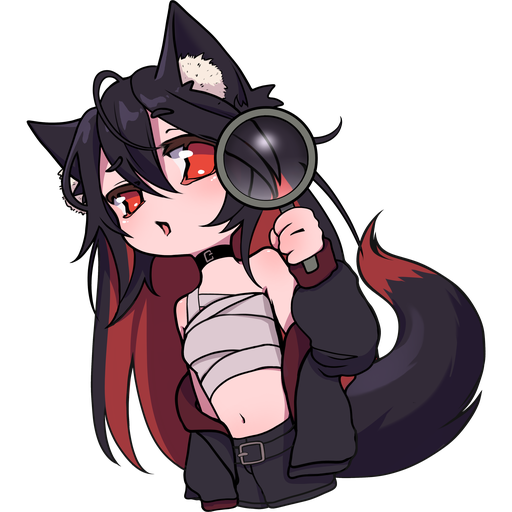

<div align="center">



<h1>TAMAMO DOCS</h1>

**Documentation for Tamamo, the proof-of-work gate for your site.**

[](https://tamamo.foxgirls.org/)
[](https://t.me/foxgirlsorg)
[](https://foxgirls.org)
[](LICENSE)

</div>

---

The source of [tamamo.foxgirls.org](https://tamamo.foxgirls.org/), built with [VitePress](https://vitepress.dev/). Code lives in [Tamamo](https://github.com/foxgirlsorg/Tamamo) and [Tamamo-webui](https://github.com/foxgirlsorg/Tamamo-webui).

## Work on the docs

```bash
npm ci
npm run dev     # http://localhost:5173, reloads as you edit
npm run build   # fails on dead links, so run it before you push
```

| Path | What |
| --- | --- |
| `docs/guide/` | What Tamamo is and how to install it |
| `docs/config/` | `tamamo.yaml`, section by section |
| `docs/guides/` | How-to guides: reverse proxies, forward auth, backups |
| `docs/modules/` | Writing and building modules |
| `docs/reference/` | Environment variables, CLI flags, files, endpoints, troubleshooting |
| `docs/public/compose/` | The compose files, served as downloads |
| `docs/.vitepress/config.mts` | Site title, navigation and sidebar |

A new page must be added to the sidebar in `config.mts`.

## Deploying

- **CI** (`.github/workflows/ci.yml`) builds pull requests and every branch except `main`.
- **Deploy** (`.github/workflows/deploy.yml`) builds `main` and publishes it to GitHub Pages.

One-time setup: **Settings → Pages → Build and deployment → Source: GitHub Actions**. The base path comes from the Pages settings, so the same build works on `<owner>.github.io/<repo>/` and on a custom domain. To build for a sub-path yourself: `DOCS_BASE=/Tamamo-docs/ npm run build`.

## Credits

- Made by [foxgirls.org](https://foxgirls.org).
- The mascot is **Eru**, the foxgirls.org mascot. Art by [tr1flu0r1d3.exe](https://t.me/tr1flu0r1d3_exe_art).

---

<div align="center">
  <sub>© 2026 <a href="https://foxgirls.org">foxgirls.org</a> &nbsp;·&nbsp; MIT License</sub>
</div>
